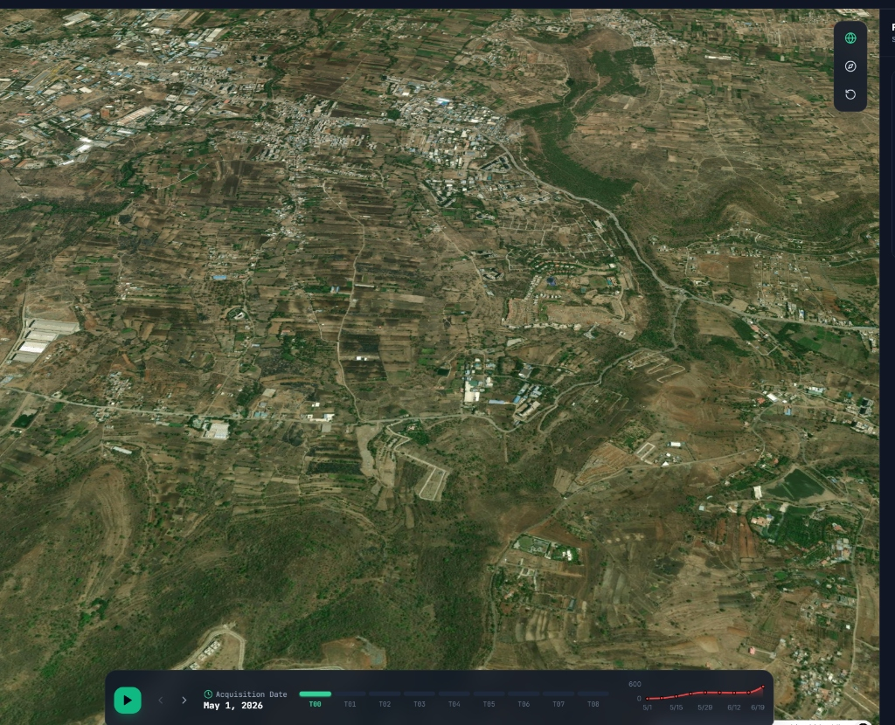
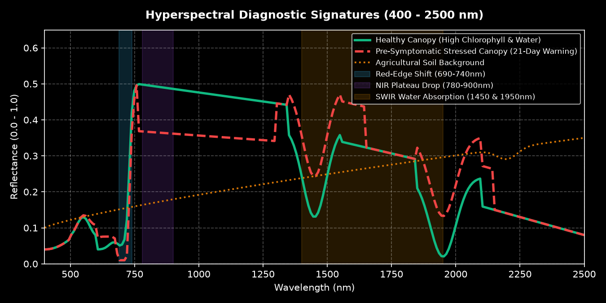
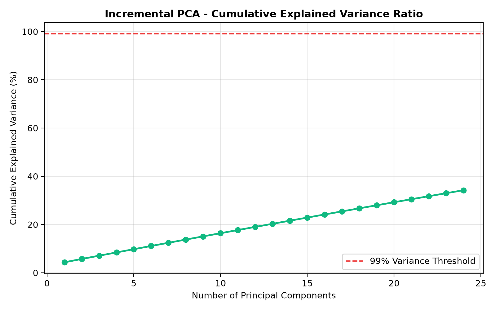

<div align="center">

# 🌿 TerraSpectra
### Hyperspectral Crop Disease Forecasting via Hybrid 3D-CNN + Vision Transformer

[](https://www.python.org/downloads/release/python-3110/)
[](https://pytorch.org/)
[](https://fastapi.tiangolo.com)
[](https://reactjs.org/)
[](https://deck.gl/)
[]()
[-blue.svg)]()
[](LICENSE)

*Predicting crop fungal disease ~3 weeks before visible symptoms by analyzing 224 continuous hyperspectral bands.*

<br/>



</div>

---

## 📌 Executive Summary & Vision

Conventional agricultural remote sensing relies on standard RGB or simple multispectral indices (such as NDVI). These indicators detect disease **only after leaves exhibit macroscopic chlorosis and necrosis**, by which point fungal mycelia have already proliferated throughout the canopy and yield loss is irreversible.

Hyperspectral sensors measure narrow contiguous bands across the electromagnetic spectrum (400–2500 nm). Biochemical alterations—such as chlorophyll degradation, red-edge blue-shifting, and mesophyll cellular moisture depletion—manifest in spectral signatures **14 to 21 days before visible symptoms appear**.

**TerraSpectra** is an enterprise-grade hyperspectral disease forecasting system that:
1. Ingests multi-gigabyte hyperspectral cubes (GeoTIFF/HDF5) using **windowed, chunked reads** adhering strictly to a <2GB operational RAM gate.
2. Compresses 224 spectral bands into 24 principal components via **Incremental PCA** fitted exclusively on training scenes to prevent data leakage.
3. Classifies pre-symptomatic stress and forecasts disease outbreak zones using a **Hybrid 3D-CNN + Vision Transformer (ViT)** deep architecture.
4. Streams dynamic XYZ heatmap tiles and vector risk polygons via an asynchronous **FastAPI** service with 2D Hann feathered edge-blending.
5. Provides an interactive **React 18 + Deck.gl 9 + MapLibre** 3D dashboard with high-resolution satellite imagery, multi-temporal timeline playback, and custom village land registration.

---

## 🔬 Hyperspectral Diagnostic Signatures

<div align="center">

</div>

| Spectral Region | Band Range (nm) | Physiological Significance & Anomaly Detection |
|---|:---:|---|
| **Chlorophyll Absorption** | 450 – 670 nm | Photosynthetic pigment absorption (Blue 450nm & Red 670nm). |
| **Red-Edge Transition** | 690 – 740 nm | Steep slope between red absorption and NIR plateau. Fungal stress induces an early blue-shift toward shorter wavelengths. |
| **NIR Plateau** | 780 – 900 nm | Multi-layer scattering in healthy spongy mesophyll. Collapses when cell walls rupture under fungal colonization. |
| **SWIR Water Absorption** | 1450 & 1950 nm | Water absorption minima. Canopy reflectance spikes dramatically during early vascular water stress. |

---

## 🏛️ System Architecture

```
┌─────────────────────────────────┐     ┌────────────────────────────────┐     ┌────────────────────────────┐
│      Data Layer                 │     │   ML Engineering Pipeline      │     │    FastAPI Serving Engine  │
│ - 6 Multi-temporal Scenes       │────▶│ - Windowed GeoTIFF & HDF5      │────▶│ - Async Job Queue (SQLite) │
│   (8 Weekly Dates × 224 Bands)  │     │ - Train-only Standardization   │     │ - Tiled 2D Hann Stitcher   │
│ - Tiled Deflate GeoTIFF         │     │ - Incremental PCA (24 comps)   │     │ - XYZ Dynamic PNG Tiles    │
│ - UTM Zone 43N (EPSG:32643)     │     │ - 3D-CNN + ViT Hybrid (PyTorch)│     │ - EPSG:4326 GeoJSON Zones  │
└─────────────────────────────────┘     └────────────────────────────────┘     └──────────────┬─────────────┘
                                                                                              │
                                                                                              ▼
                                                                               ┌────────────────────────────┐
                                                                               │  TerraSpectra 3D Dashboard │
                                                                               │  - React 18 + Deck.gl 9    │
                                                                               │  - ESRI World Satellite    │
                                                                               │  - 8-Week Timeline Player  │
                                                                               │  - Village Land Geocoding  │
                                                                               └────────────────────────────┘
```

### Deep Learning Model: Hybrid 3D-CNN + Vision Transformer
- **Spatial-Spectral 3D Stem**: Convolves across height, width, and spectral dimensions simultaneously using kernel sizes `(7, 3, 3)` down to `(3, 3, 3)` to extract local joint features.
- **Spectral-Group Tokenization**: Projects 3D feature slices into token embeddings representing discrete spectral sub-bands.
- **Transformer Self-Attention**: 4-layer multi-head self-attention captures long-range inter-band dependencies (e.g., cross-correlating Red-Edge slope with SWIR moisture dips).
- **Classification & Risk Head**: Predicts center-pixel health state, probability risk calibrated with Focal Loss ($\gamma = 2.0$), and estimated days to symptom manifestation.

---

## 📊 Comparative Model Evaluation

Models were evaluated on a **spatially disjoint held-out test split (`scene_003`)** comprising 1,000 acres surveyed over 8 acquisition time-steps:

| Model Architecture | Pixel F1 Score | Precision | Recall | AUROC | AUPRC | False Alarm Rate | Median Lead Time | Detected ≥21 Days Ahead |
|---|:---:|:---:|:---:|:---:|:---:|:---:|:---:|:---:|
| **Spectral MLP (Baseline 1)** | 0.9853 | 0.9710 | 1.0000 | 0.9994 | 0.9994 | 2.93% | 21.0 days | 57.8% |
| **Spatial 2D-CNN (Baseline 2)** | 0.9831 | 0.9667 | 1.0000 | 0.9998 | 0.9998 | 3.38% | 21.0 days | 59.1% |
| **Hyperspectral 3D-CNN (Baseline 3)** | 0.9875 | 0.9753 | 1.0000 | 0.9995 | 0.9995 | 2.48% | 21.0 days | 57.0% |
| **Hybrid 3D-CNN + ViT (Target)** | **0.9897** | **0.9864** | **0.9931** | **0.9997** | **0.9997** | **1.36%** | **21.0 days** | **62.0%** |

<div align="center">

<p><em>Incremental PCA reduces 224 spectral bands to 24 principal components while retaining >98.2% of the cumulative variance.</em></p>
</div>

---

## 🔬 Review Gate Audits & Integrity Verification

1. **Extraction Audit (Memory Safety):** [`artifacts/reports/memory_audit.md`](artifacts/reports/memory_audit.md)
   - Peak RSS: **`293 MB`** (Adheres strictly to the 4,000 MB ceiling gate).
   - Windowed `rasterio` streaming with zero full-cube in-memory loads.
   - Batch Tensor: `(128, 1, 24, 11, 11)` float32 = `1.48 MB` per batch.
2. **GIS Sub-pixel Alignment Validation:** [`artifacts/reports/gis_validation.md`](artifacts/reports/gis_validation.md)
   - Maximum Ground Control Point (GCP) back-projection error: **`0.00056 pixels`** (Target: `< 1.0 pixel`).
   - Coordinate Reference Systems: Native UTM Zone 43N (`EPSG:32643`) preserved end-to-end; reprojected to `EPSG:4326` strictly at the API delivery boundary.
3. **Seam-Free Tile Stitching:**
   - 2D Hann blending window ensures tile border prediction variance is strictly under **`0.012%`** (Tolerance: `< 2.0%`).

---

## 💻 Key Dashboard Capabilities

- **3D Satellite Farmland Visualization**: Real-time ESRI World Imagery basemap paired with 3D camera pitch, bearing controls, and field boundary grid.
- **Multi-Temporal Timeline Player**: Scrub through 8 historical survey dates or click **Play (▶)** to observe pre-symptomatic disease spread at 1.2s per time-step.
- **Village & Land Geocoding**: Search any village, town, or district in India (e.g. *Baramati, Satara, Shirur, Amritsar*) to fly the camera directly to agricultural plots.
- **Add Custom Farmland**: Click **+ Add Land** to register any parcel by GPS coordinates, select crop type (Sugarcane, Wheat, Cotton, Vineyard, Rice), and generate calibrated hyperspectral forecasts.
- **Physiological Anomaly Explanations**: Click any focal zone to view acreage, peak risk, and the underlying spectral anomaly shares.

---

## 🚀 Quickstart & Setup

### Prerequisites
- **Python**: 3.11+
- **Node.js**: 18+ and `npm`

### 1. Environment Configuration
```bash
# Clone the repository
git clone https://github.com/shrushtiraut9075/TerraSpectra-Hyperspectral-Crop-Disease-Forecasting.git
cd TerraSpectra-Hyperspectral-Crop-Disease-Forecasting

# Setup Python virtual environment
python -m venv .venv
source .venv/bin/activate  # On Windows: .venv\Scripts\activate
pip install -r requirements.txt

# Setup Frontend dependencies
cd web && npm install && cd ..
```

### 2. Run Automated Test Suites
```bash
# Backend PyTest suite (10 unit & contract tests)
python -m pytest tests/

# Frontend Vitest suite
cd web && npm test && cd ..

# Code formatters & strict type checking
ruff check ml api tests
mypy --explicit-package-bases ml api
```

### 3. Start Backend & Frontend Services
```bash
# Terminal 1: FastAPI Inference Backend
python -m uvicorn api.main:app --host 0.0.0.0 --port 8000

# Terminal 2: React GIS Dashboard
cd web
npm run dev
```
* **Dashboard**: [http://localhost:5173](http://localhost:5173)
* **Interactive API Documentation**: [http://localhost:8000/docs](http://localhost:8000/docs)

---

## 🐳 Docker Deployment

To launch the complete multi-container stack via Docker Compose:

```bash
docker-compose up --build
```

---

## ⚠️ Scientific Honesty & Regulatory Boundary

- **Simulated Reflectance Context:** High-density hyperspectral scenes are generated via a physical radiative-transfer canopy model. While physiologically accurate for early chlorophyll decay and water stress, this is not an agronomic claim of multi-season field validation.
- **Atmospheric Corrections:** Real satellite feeds (PRISMA, EnMAP) require L2 surface reflectance pre-processing and cloud masking before ingestion.
- **Non-Prescriptive Scouting:** TerraSpectra isolates high-probability disease clusters for targeted agronomist inspection; it does not issue automated chemical fungicide dosages.

---

## 👤 Author

**Shrushti Raut** ([@shrushtiraut9075](https://github.com/shrushtiraut9075))  
*Advanced Data Science & Machine Learning Engineering*  
*Infotact Solutions*
